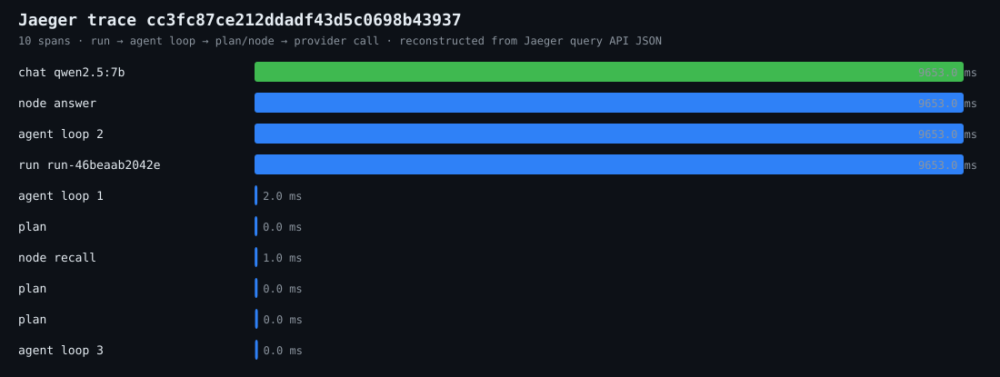

# S15Code — the budget-aware agent runtime

Session 15 of EAGV3. Hand a run a **ceiling** and a **principal**, and the agent
plans against them: every node declares the capability tier it needs, the
allowance is re-divided across the live frontier on every planning round, and a
controller admits, downgrades, branches or refuses each call before it is made.
The same durable event journal the graph already writes is then exported as
OpenTelemetry spans, with token usage and cost per span.

Two things are true no matter what the model does with its tokens:

- **No call is made without being metered.** The controller owns the transport;
  there is no code path to a provider that skips the ledger.
- **No run spends past its ceiling.** Enforcement is deterministic code. A budget
  asked for in a prompt leaks — models are token-elastic (TALE, 2026), so they
  sail past a tight ceiling while sincerely agreeing to it.

## One package

`S14Code` shipped two packages side by side, with the session's own work hidden
inside the previous session's namespace. This repo has **exactly one importable
package**, and nothing is nested inside a prior session's name.

```
S15Code/
├── s15code/
│   ├── main.py            FastAPI app factory
│   ├── cli.py             `s15code serve`
│   ├── routes.py          runs, facts, documents, memory search, trace
│   ├── a2a_routes.py      agent card + JSON-RPC
│   ├── gateway.py         the gateway client (never holds a credential)
│   ├── planner.py         the constrained GraphPatch proposal boundary
│   ├── runtime.py         one request through the live graph
│   ├── tools.py           the small non-browser skill surface
│   ├── core/
│   │   ├── live_graph/    executor, durable event journal, patches   (from S13)
│   │   ├── memory/        typed scoped memory, semantic chunking     (from S13)
│   │   └── a2a/           the agent-to-agent boundary                (from S13)
│   ├── ui/                catalog, validator, surface, AG-UI, HITL   (from S14)
│   ├── economics/         NEW — budget-aware planning
│   │   ├── config.py        loads the three YAML files
│   │   ├── pricing.py       per-model prices
│   │   ├── tiers.py         the capability ladder; a node declares a tier
│   │   ├── budget.py        allowance, spend, reservations, allocation
│   │   ├── policy.py        proceed / downgrade / branch / refuse
│   │   └── controller.py    the hard controller at the call seam
│   ├── telemetry/         NEW — the same journal, as OTel spans
│   │   └── spans.py         run → agent loop → plan → node → provider call
│   └── evals/             NEW — did the answer RESOLVE the task?
│       ├── config.py        the rubric, the bar and the judge panel, from YAML
│       ├── judge.py         LLM-as-judge on a generic, task-agnostic rubric
│       └── tasks.py         reads a task set; never contains one
├── config/                tiers.yaml · pricing.yaml · budgets.yaml · evals.yaml
├── proofs/                the generic proof harness
│   └── tasks/               task sets, as DATA a reviewer can replace
└── tests/
```

## The elegant reuse

The graph writes **one** durable journal. It now has three consumers, and no
parallel event system exists:

| Consumer | Reads the journal as |
|---|---|
| the executor | graph replay and crash recovery (S13) |
| `s15code.ui.agui` | AG-UI events for a browser (S14) |
| `s15code.telemetry.spans` | OpenTelemetry spans for a collector (S15) |

The controller writes each metered call into the node's own result, so the
journal carries tokens, cost, tier and the budget decision. Delete the
materialised graph and the trace still builds from the tape alone — `p4` checks
exactly that.

## Nothing is hardcoded

No tier name, model, provider, price, threshold or budget appears in Python.

| Decision | Lives in |
|---|---|
| what tiers exist, and what each expands to on the wire | `config/tiers.yaml` |
| which tier a graph role asks for | `config/tiers.yaml` → `role_tiers` |
| what a model costs, and cache-read discounts | `config/pricing.yaml` |
| default allowance, per-principal caps | `config/budgets.yaml` |
| downgrade / refuse ratios, reserve, call ceilings, token estimation | `config/budgets.yaml` |

`config/` is resolved from `S15_CONFIG_DIR` when set, otherwise from beside the
package. The unit tests build their **own** ladder with invented tier names, which
is the real check that the library never depends on the shipped ones.

## Run it

```bash
uv sync
uv run pytest -q
uv run ruff check .
uv run s15code serve            # http://127.0.0.1:8113
```

The gateway is a separate process on `http://127.0.0.1:8111` (`GLC_BASE_URL`).
S15Code holds no provider credential; copy `.env.example` to `.env` and set paths,
never keys.

A budgeted run over HTTP:

```bash
curl -s localhost:8113/v1/agent/runs -H 'content-type: application/json' -d '{
  "tenant_id": "acme", "project_id": "research", "user_id": "rohan",
  "prompt": "<any task>", "budget": 0.02
}' | jq '.budget'
```

The response carries a `budget` ledger (total, spent, remaining, pressure, every
charge, every refusal), the `allocations` the planner made each round, and the
`tier` each node declared. `GET /v1/agent/runs/{id}/trace` returns the same run as
a span tree.

Omit `budget` and the run behaves exactly as it did before economics existed —
the layer is additive.

## Proofs

One harness, one code path, six proofs. Each takes the **task (or task set, or
pair set), budget and principal as arguments**, asserts real invariants, exits
non-zero on failure, and writes JSON to `proofs/out/`.

```bash
uv run python proofs/p1_cost_per_task.py    --tasks proofs/tasks/mixed.jsonl
uv run python proofs/p2_budget_holds.py     --task "<any task>" --budget 0.02
uv run python proofs/p3_denial_of_wallet.py --task "<any task>" --budget 0.002
uv run python proofs/p4_trace_export.py     --task "<any task>" --budget 0.02
uv run python proofs/p6_cache_savings.py    --pairs proofs/pairs/paraphrases.jsonl
uv run python proofs/p7_cross_model_ladder.py --task "<any task>"
```

| Proof | Proves |
|---|---|
| `p1_cost_per_task` | The same task set through always-frontier, always-cheapest-with-retries and the budget-aware cascade, on one ledger. Reports spend, calls, cost per call and **cost per resolved task** per strategy, with "resolved" decided by a generic rubric judge (`s15code.evals`) and never by a per-task answer key. Whether the cheapest rung shows the signature failure mode — lower cost per call, higher cost per resolved task — is reported as a finding, not asserted. |
| `p2_budget_holds` | A run given a ceiling stays under it at every ceiling; a tight allowance downgrades the tier a node asked for; an unaffordable ceiling refuses instead of overspending; provider calls and ledger entries agree exactly. |
| `p3_denial_of_wallet` | An adversarial planner that earns one more node from every outcome, forever, cannot spend past the ceiling. Refusals are visible graph failures. Reports the bill the same loop would have run up uncontrolled. |
| `p4_trace_export` | The journal exports as `run → agent loop → plan → node → provider call`, with `gen_ai.usage.*` and cost on every provider-call span, summing exactly to the ledger. Content capture off. Works with no collector. |
| `p6_cache_savings` | The gateway's semantic cache, against the **real** embedder. A 768-dim nomic vector is confirmed to be neither a stub nor a constant; the similarity the gateway acts on is checked against a cosine computed independently; a hit is billed $0 and its saving is read off the cold call it replaced. Then the threshold is **swept** over a labelled pair set (`proofs/pairs/`), reporting true- and false-positive rates per threshold and per negative family. Whether a collision-free threshold exists is a finding, not an assertion — and on the shipped set it does not. |
| `p7_cross_model_ladder` | Every rung is a different model on a different provider; budget pressure walks the whole ladder down, one model at a time; projected cost is monotone; the measured top-to-bottom spread is reported as a multiple. |

**Two modes, one code path.** If the gateway at `--base-url` answers, the proofs
make real calls and meter real money. Otherwise (or with `--offline`) a
deterministic transport stands in — the policy, ladder, budget, journal and span
export are all the real implementation, only the network is replaced. That is what
lets CI run the same proof with no key and no collector.

The ceilings `p2` uses to force a downgrade and a refusal are **derived from the
configured ladder**, not written down, so editing `config/tiers.yaml` changes the
numbers rather than breaking the proof.

Useful flags: `--offline`, `--respond-as ui`, `--principal tenant/project/user`,
`--otel-endpoint http://127.0.0.1:4318/v1/traces`, `--config-dir`, `--label`,
`--live-embeddings`.

## Observability

`s15code.telemetry.export_run` turns a journal into spans through the real OTel
SDK. Attributes follow the GenAI semantic conventions —
`gen_ai.operation.name`, `gen_ai.provider.name`, `gen_ai.request.model`,
`gen_ai.usage.input_tokens`, `gen_ai.usage.output_tokens`. Those conventions are
pre-stable and moved to their own repository in June 2026 with no tagged release,
so **cost has no blessed attribute yet**: it is emitted as `s15.cost` with
`s15.currency`, clearly marked as a vendor extension rather than pretending to be
standard.

Set `S15_OTEL_EXPORTER_ENDPOINT` (or `--otel-endpoint`) to send the spans to
Jaeger or any OTLP receiver; Jaeger ingests OTLP natively. Leave it unset and the
span tree is still built and assertable in memory while nothing goes over the
wire, so tests need no collector.

**Content capture is off by default.** Prompts and completions are PII. They are
attached only when a caller passes `capture_content=True` or sets
`S15_OTEL_CAPTURE_CONTENT=1`.

## What the meter covers, honestly

The ledger covers **gateway model calls** — the paid ones. Semantic-memory
embeddings run locally against Ollama and never touch the gateway, so they cost
nothing per token and are not in the ledger.

Admission prices the **worst case**: output is bounded by the tier's `max_tokens`,
which the provider honours, and input by an over-estimate of the prompt actually
being sent (`chars_per_token` and `input_estimate_safety` in `budgets.yaml`). That
makes the projection a real upper bound rather than an average. If a provider
ignored `max_tokens` the call already in flight could overshoot — so the ledger is
also an absolute stop, and `max_calls_per_run` / `max_calls_per_node` bound the
loop even when every price estimate is wrong. A test drives exactly that case.

## Carried forward vs new

**Carried forward** (imports renamed to `s15code.*`, behaviour unchanged): the
live graph and its journal, scoped memory and semantic chunking, the A2A boundary
and gRPC binding, the A2UI catalog/validator/surface/AG-UI/HITL layer, the
gateway boundary, the deterministic and LLM planners, the non-browser skills.

**New in this session**: `s15code/economics/` (six modules), `s15code/telemetry/`,
`config/` (three files), the `budget`/`principal` arguments on a run, the
`/trace` route, and a rewritten `proofs/` harness.

**Deliberately dropped**: S14's `showcase.py` and its `/dashboard` route hardcoded
one use case (a five-paper research corpus, with its title in the code). The
`/v1/harness/surface` route depended on one specific S14 proof artefact. Both
would have violated the no-hardcoding rule this session is built around.

The generated protobuf modules under `s15code/core/a2a/` keep their original
filenames. They are reproduced verbatim because the serialized descriptor is
keyed on the `.proto` file name, and hand-editing generated gencode is worse than
a stale name.

---

<a id="part-1"></a>
## Assignment evidence — Part 1: reproduce the floor

All evidence below was produced on 1 September 2026 by the live gateway and
local models. It is committed under [`docs/evidence/`](docs/evidence/) as JSON,
not copied from terminal output.

### Important pricing disclosure

The models run locally through Ollama, so no provider billed dollars. Dollar
figures use the explicit **declared rate card** in
[`config/pricing.yaml`](config/pricing.yaml): $0.10/$0.40 per million tokens for
the 1B rung, $0.30/$1.20 for the 3B rung, and $1.00/$4.00 for the 7B rung.
Token counts, latency, routing, resolution verdicts, and refusals are measured;
only conversion from tokens to dollars is synthetic. Reporting these values as
real provider charges would be false.

The gateway extension that registers the second local slot is in the public
[`tanmays369/glc_v4`](https://github.com/tanmays369/glc_v4) fork. `ollama` and
`ollama_edge` are separate daemons, queues, rate states, and circuit breakers,
but they run on one machine and are not independent vendors.

### Test and proof floor

- glc_v4: **456 passed, 1 skipped**
- S15Code: **277 passed**
- `p1`: all checks passed over the shipped 12-task file; 59 answering calls
  equalled 59 ledger charges, with zero transport failures and zero unusable
  judge samples ([result](docs/evidence/p1_cost_per_task_floor.json)).
- `p2`: budget held, a tight allowance downgraded frontier to standard, and an
  impossible allowance refused before transport
  ([result](docs/evidence/p2_budget_holds.json)).
- `p3`: a loop kept asking for 80 rounds; 23 calls were admitted, 57 refused,
  and every refusal was a visible `BudgetRefused` graph failure
  ([result](docs/evidence/p3_denial_of_wallet.json)).
- `p4`: the exported provider-call cost was **$0.00106400**, exactly equal to
  the ledger (delta zero); the trace was fetched back from Jaeger and contained
  no prompt or completion text ([result](docs/evidence/p4_trace_export.json)).
- `p7`: every rung served its configured model; both downgrade steps changed
  the model. Projected spread was 39.3x and measured spread was 3.82x
  ([result](docs/evidence/p7_cross_model_ladder.json)).

### Four captured runs

The common ordered event shape was:

`run_started → graph_patched → task_started(recall) → task_succeeded(recall) → graph_patched → task_started(answer) → task_succeeded|task_failed(answer) → graph_patched`

1. **CrashLoopBackOff** — requested frontier and served
   `ollama_edge/qwen2.5:7b`; 248 input / 208 output tokens; $0.001080;
   trace `cc3fc87ce212ddadf43d5c0698b43937`. The final answer gave three
   diagnostic commands. [Run, journal, spans](docs/evidence/run1_crashloop.json)
   · [Jaeger response](docs/evidence/jaeger_cc3fc87ce212ddadf43d5c0698b43937.json)
2. **ImagePullBackOff** — requested frontier and served
   `ollama_edge/qwen2.5:7b`; $0.001059; trace
   `7654bdf03b8fbfac757cd2026a726be9`.
   [Run, journal, spans](docs/evidence/run2_imagepull.json)
   · [Jaeger response](docs/evidence/jaeger_7654bdf03b8fbfac757cd2026a726be9.json)
3. **HTTP budget status** — requested frontier and served
   `ollama_edge/qwen2.5:7b`; answer `402`; $0.000735; trace
   `dceacc434b42228f416605cf4fc59048`.
   [Run, journal, spans](docs/evidence/run3_http402.json)
   · [Jaeger response](docs/evidence/jaeger_dceacc434b42228f416605cf4fc59048.json)
4. **Unaffordable call** — requested frontier under a $0.00003 ceiling.
   No model was served, spend stayed $0, and one refusal was recorded. The
   answer node failed with `BudgetRefused`; trace
   `f86dcc101182b9ebc60153f048965918`.
   [Run, journal, spans](docs/evidence/run4_tight_budget.json)
   · [Jaeger response](docs/evidence/jaeger_f86dcc101182b9ebc60153f048965918.json)

The complete compact capture is
[`four_runs_summary.json`](docs/evidence/four_runs_summary.json), and the
gateway ledger extract is
[`gateway_ledger_recent.json`](docs/evidence/gateway_ledger_recent.json).



### Honest limitation exposed by the traces

The refused run has nine agent spans but no provider-call span, because no
provider call existed. The refusal is visible in the graph journal and budget
`refusal_log`, not as a billed model span. An operator looking only for provider
spans would therefore miss the system's safest behavior. A production dashboard
must ingest refusal events as a separate control signal.

<a id="part-2"></a>
## Assignment evidence — Part 2: SRE routing policy

The workload is 18 self-contained platform/SRE triage tasks in
[`proofs/tasks/sre_triage.jsonl`](proofs/tasks/sre_triage.jsonl): Kubernetes API
versions, Pod diagnosis, Jenkins investigation order, Jira JQL, IDP stack
nesting, budget arithmetic, routing pools, caching, and billed-empty-output
diagnosis. Difficulty mix: 4 trivial, 6 moderate, 8 hard.

The ladder and role policy are data in [`config/tiers.yaml`](config/tiers.yaml):

- economy — `ollama/llama3.2:1b`, max 512 tokens
- standard — `ollama/qwen2.5:3b`, max 1,024 tokens
- frontier — `ollama_edge/qwen2.5:7b`, max 2,048 tokens

Bulk retrieval and formatting request economy, operational synthesis requests
standard, and the final answer node requests frontier. The hard controller in
[`config/budgets.yaml`](config/budgets.yaml) downgrades at 50% pressure, refuses
at 90%, reserves 20% for the terminal node, and caps a run at 60 calls.

The judge uses the generic five-criterion rubric from
[`config/evals.yaml`](config/evals.yaml). Four criteria have weight 1 and the
task-specific success criterion has weight 2. Resolution requires a weighted
score of at least 0.75 and no individual criterion below 0.5. The floor matters:
a fluent, specific, complete, internally consistent answer to the wrong question
scores 4/6 = 0.667 on generic criteria and cannot pass. `phi4-mini` is disjoint
from all answering models, but it is a single local judge, so inter-judge
agreement cannot be measured and its verdicts have that explicit limitation.

<!-- SRE_RESULTS_START -->
The live measurement completed in 1,019.2 seconds. All 90 answering calls that
returned had matching ledger charges; 8 provider failures reported no usage and
were kept separate rather than assigned invented costs. Full output:
[`p1_cost_per_task_sre.json`](docs/evidence/p1_cost_per_task_sre.json) and
[`p1_sre_run.log`](docs/evidence/p1_sre_run.log).

| Strategy | Spend | Calls | Cost/call | Resolved | Cost/resolved task |
|---|---:|---:|---:|---:|---:|
| A: always frontier | $0.00882300 | 18 | $0.00049017 | 9/18 | $0.00098033 |
| B: always economy, two retries | $0.00290220 | 42 | $0.00006910 | 6/18 | $0.00048370 |
| C: budget-aware cascade | $0.00349260 | 30 | $0.00011642 | 10/18 | $0.00034926 |

Against always-frontier, the policy reduced cost per call by **76.25%**, reduced
cost per resolved task by **64.37%**, and resolved one additional task in this
single run. Those percentages are consequences of the declared rate card, not
provider invoices.

### Break-even

The cheap strategy used at most `k=3` attempts. From its measured cost/call and
the frontier's measured cost/resolved task:

`r* = k / (C/c - 1 + k) = 18.5%`

Economy resolved 33.3%, leaving 14.8 percentage points of measured headroom
above the frontier break-even rate. Against the cascade, however, its break-even
was 42.5%; economy sat below it. This is the session's signature trap: B was
40.6% cheaper per call than C but **38.5% more expensive per resolved task**.

### Where the policy chose wrongly

On `s11_eks_api_table`, the frontier baseline answered all five Kubernetes API
versions correctly and resolved for **$0.00029000**. The policy opened on
economy, which incorrectly put Deployment, Job, and Ingress on `v1`, then paid
standard for invented software-like versions such as `2.5.0`. Those two wrong
attempts cost **$0.00013320**. Its frontier escalation then hit a real 120-second
`ReadTimeout`, so the task remained unresolved.

This is both a routing failure and an operational limitation: the cheap-first
policy bought two unusable answers before asking the only rung that had
demonstrated success, while the single local frontier slot had no failover when
it timed out. It would be dishonest to attribute the final failure solely to
model quality; the evidence records both causes.

### Judging cost

Evaluation used 46 judge calls costing **$0.01648380** on the same declared card:
4.72x the policy workload it judged and 1.87x the always-frontier workload.
There were zero unparseable verdicts and 44 memoized verdict reuses. The
meta-cost is larger than the work, so an online router should not call this
judge on every production request.
<!-- SRE_RESULTS_END -->

<a id="part-3"></a>
## Assignment evidence — Part 3: attack the budget

[`proofs/p8_attack_policy.py`](proofs/p8_attack_policy.py) attacks the policy in
four ways and exits non-zero unless every control holds
([machine-readable result](docs/evidence/p8_attack_policy.json)).

- **Runaway loop:** under a $0.002 ceiling, spend flattened at **$0.001764**;
  the loop reached 80 rounds and produced **38 visible refusals**. With a loose
  ceiling, all eight sampled rounds kept spending. Extrapolating that measured
  rate to 10,000 rounds gives about **$1.61** on the declared card.
- **Unaffordable frontier:** projected $0.00021060 against $0.00000029
  remaining; shortfall $0.00021031. Calls: 0, spend: 0, refusals: 1.
- **Forced full cascade:** the same task climbed
  `llama3.2:1b → qwen2.5:3b → qwen2.5:7b` and spent **$0.00037440**. A wrong
  confidence signal buys every rung it passes.
- **Failure after token consumption:** the successful call was charged; two
  subsequent errors with no reported usage were counted as transport failures
  and not invented as charges. A fresh exhausted request was refused and its
  envelope remained in `refusal_log`.

This demonstrates the distinction the policy relies on: billed calls become
ledger charges and provider spans; pre-call refusals become explicit graph
failures and refusal records.

## Reproduce from a fresh checkout

Prerequisites: Python 3.11+, `uv`, Ollama, and about 11 GB for the four local
models. No cloud API key is needed.

```bash
git clone https://github.com/tanmays369/glc_v4.git
git clone https://github.com/tanmays369/S15Code.git

ollama pull llama3.2:1b
ollama pull qwen2.5:3b
ollama pull qwen2.5:7b
ollama pull phi4-mini

# Terminal 1: stock Ollama daemon
ollama serve

# Terminal 2: independent local provider slot
OLLAMA_HOST=127.0.0.1:11435 ollama serve

# Terminal 3: Jaeger without Docker (use docker-compose.observability.yml if preferred)
cd glc_v4
scripts/jaeger_local.sh --start

# Copy the assignment gateway policy and start on 8121.
mkdir -p runtime/glc
cp examples/s15/pricing.yaml runtime/glc/pricing.yaml
cp examples/s15/routing.yaml runtime/glc/routing.yaml
export GLC_CONFIG_DIR="$PWD/runtime/glc"
export OLLAMA_MODEL=qwen2.5:3b
export OLLAMA_URL=http://127.0.0.1:11434
export OLLAMA_EDGE_MODEL=qwen2.5:7b
export OLLAMA_EDGE_URL=http://127.0.0.1:11435
export LLM_ORDER=ollama,ollama_edge
export OTEL_EXPORTER_OTLP_ENDPOINT=http://127.0.0.1:4318
uv sync
uv run glc serve --port 8121

# Terminal 4: runtime and proofs
cd ../S15Code
export GLC_BASE_URL=http://127.0.0.1:8121
export S15_OTEL_EXPORTER_ENDPOINT=http://127.0.0.1:4318/v1/traces
uv sync
uv run pytest -q
uv run python proofs/p2_budget_holds.py --task "Diagnose CrashLoopBackOff" --budget 0.02
uv run python proofs/p3_denial_of_wallet.py --task "Diagnose CrashLoopBackOff" --budget 0.001 --loop-limit 80
uv run python proofs/p4_trace_export.py --task "Diagnose CrashLoopBackOff" --budget 0.02 \
  --otel-endpoint http://127.0.0.1:4318/v1/traces
uv run python proofs/p7_cross_model_ladder.py --task "Diagnose CrashLoopBackOff"
uv run python proofs/p8_attack_policy.py --task "Diagnose CrashLoopBackOff" --budget 0.002
uv run python proofs/p1_cost_per_task.py --tasks proofs/tasks/sre_triage.jsonl \
  --principal course/s15/reviewer --label sre
```
